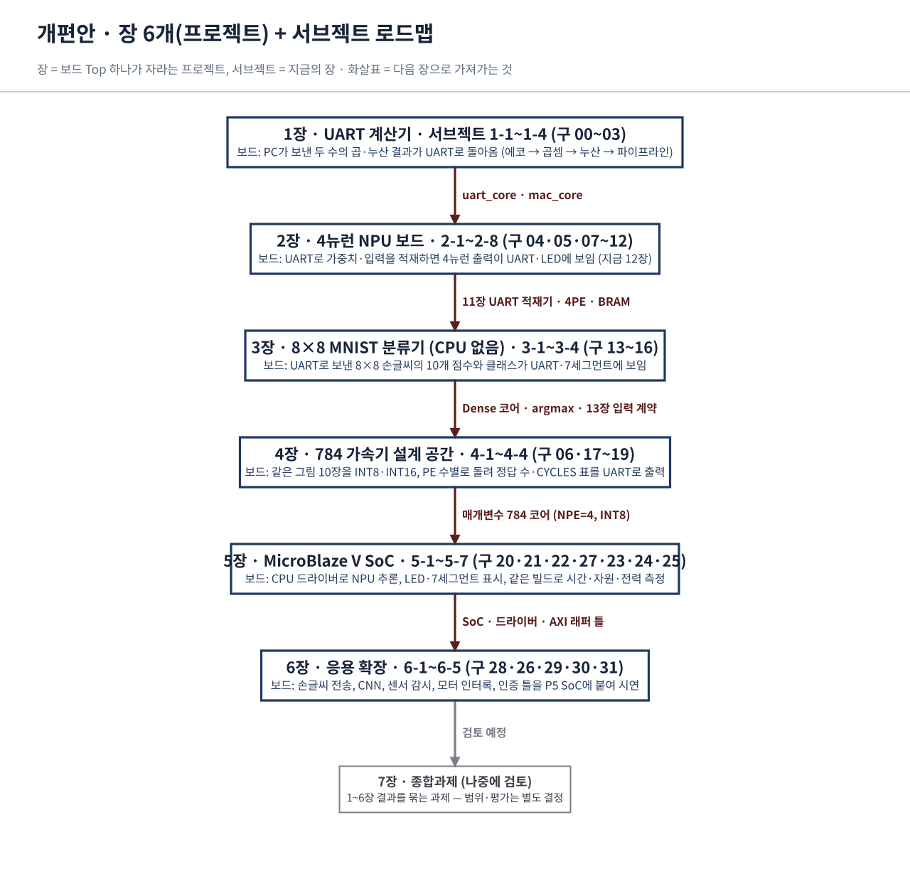

# 개편안 — 장(프로젝트) · 서브젝트 구조, 누적 보드 확인 (설계, 2026-11-19)

> 상태: **설계 확정 (2026-11-19)** — 6절 결정 반영. 코드·안내서는 아직 바꾸지 않았다. 개편 전 결과는 브랜치 `archive/v02-ch00-31`(c7c2341)에 보관했다.
> VS Code 동기화 결과(13~20장 코드, Vivado 증거)가 들어오면 이 표를 그 결과와 맞춘 뒤 개편을 시작한다.

## 1. 원칙

1. **장(프로젝트)마다 보드 Top 하나가 자란다.** 서브젝트는 그 Top에 기능 하나를 더하는 단계다. 단위 합성(OOC)은 보조 확인으로 내린다.
2. **학습목표 = 보드 관찰.** 서브젝트의 목표는 "보드에서 무엇을 넣으면 무엇이 보이는가" 한 줄로 쓴다.
3. **기대 화면을 먼저.** 서브젝트마다 시뮬레이션(또는 펌웨어 기록의 RTL 재생)으로 보드 기대 출력을 만들어 싣는다. 보드 결과를 그 표와 맞춰 본다.
4. **보드에 드러나지 않으면 드러나게.** 비교·측정 서브젝트는 정답 수·CYCLES 값을 UART로 출력해 보드에서 확인한다.
5. **앞 장 파일은 고치지 않고 가져온다.** 장 첫머리에 '가져오는 파일' 표, 끝에 누적 보고서와 시연.
6. **분담.** 웹 Claude: 기대 화면·Top·XDC·절차·안내서. VS Code·보드: 합성·타이밍·비트스트림·보드 확인과 증거.

## 1-1. 장·서브젝트와 '지금 위치'

- **장 = 프로젝트**: 보드 Top 하나, 끝에 보드 시연 하나, 학습 성과 하나. 장 페이지에 목표·최종 구조도·가져오는 파일·시연·누적 보고를 둔다.
- **서브젝트 = 지금의 장**: Top에 기능 하나를 더하는 단계. 서브젝트 페이지는 절차·코드·기대 화면 중심으로 짧게.
- **위치 표시 (모든 서브젝트 페이지 맨 위)**: 장 목표(시연 한 줄) · 진행 막대(예: 3장 ■■□□ 2/4) · 이미 보드에서 확인한 것(앞 서브젝트 결과 목록) · 이번 서브젝트로 새로 보이는 것 · 남은 것.
- **성과 기록**: 서브젝트마다 보드 결과를 기대 화면과 비교한 표 한 줄을 남기고, 장 끝 누적 보고에서 그 줄들을 모아 시연 결과와 함께 성과로 정리한다.
- **번호·폴더**: 화면 표시는 "3-2 그룹·argmax (구 14장)". 폴더 `chNN/`·증거 경로는 VS Code 결과 반영이 끝날 때까지 유지.

## 2. 로드맵

| 장 (프로젝트) | 서브젝트 (지금 장) | 끝 시연 (보드) | 다음 장으로 가져가는 것 |
|---|---|---|---|
| 1장 UART 계산기 | 00~03 | PC가 보낸 두 수의 곱·누산 결과가 UART로 돌아옴 | `uart_core` · `mac_core` |
| 2장 4뉴런 NPU 보드 | 04·05·07~12 | UART 적재 → 4뉴런 출력 UART·LED (지금 12장) | UART 적재기 · 4PE · BRAM |
| 3장 8×8 MNIST (CPU 없음) | 13~16 | 8×8 손글씨 → 점수 10개·클래스 UART·7세그먼트 | Dense 코어 · argmax · 입력 계약 |
| 4장 784 가속기 설계 공간 | 06·17~19 | 그림 10장 × 설정(INT8·INT16, PE 수) 정답 수·CYCLES 표 UART | 매개변수 784 코어 (NPE=4, INT8) |
| 5장 MicroBlaze V SoC | 20~25·27 | CPU 드라이버 추론 → UART·LED·7세그먼트, 같은 비트스트림으로 시간·자원·전력 | 동결 주소맵 SoC (NPU·SEG7 포함) · 드라이버 |
| 6장 응용 확장 | 26·28~31 | 손글씨 숫자 인식(28) + 응용 1~2개를 5장 SoC에 ELF로 붙여 시연 | — |
| 7장 종합과제 | (나중에 검토) | 1~6장을 묶는 과제 | — |

## 2-1. 일정 (장 = 1일 또는 2일, 하루 8시간) — 초안

지금은 장 하나가 1일(8시간)이라 31장 = 32일이다. 개편 뒤에는 장마다 1~2일, 합계 10일(종합과제 제외)이다.
서브젝트는 Top에 붙이는 단계라 짧아진다. 보드 확인은 **서브젝트마다** 비트스트림을 만들어 하는 것을 기본으로 한다(최소 하루 2번). 빌드 시간이 길어 일정이 밀리면 이웃 서브젝트 두 개를 묶어 한 번에 확인한다. 서브젝트마다 시뮬레이션 기대 화면을 먼저 만든다.

| 장 | 일수 | 1일차 오전 → 보드 확인 | 1일차 오후 → 보드 확인 | 2일차 오전 → 보드 확인 | 2일차 오후 → 시연 |
|---|---|---|---|---|---|
| 1장 UART 계산기 | 1일 | 1-1 에코 → 에코 · 1-2 MAC → 누산 | 1-3 DSP → DSP 1개 · 1-4 파이프라인 → 시연 | — | — |
| 2장 4뉴런 NPU | 2일 | 2-1 BRAM → 쓰고 읽기 · 2-2 양자화 → 양자화 값 | 2-3 내적 → 내적 · 2-4 4PE → 내적 4개 | 2-5 Dense → 4뉴런 · 2-6 Core → 한 번 시작 | 2-7 UART 적재 → 명령 · 2-8 통합 → 시연 |
| 3장 8×8 MNIST | 2일 | 3-1 입력 적재 → 64화소 되읽기 | 3-2 그룹·argmax → 점수 10개 | 3-3 Dense 블록 → 검증합 | 3-4 2층 → 시연 (7세그먼트) |
| 4장 784 설계 공간 | 1일 | 4-1 정밀도 기초 → INT8·INT16 차이 · 4-2 타일 → 784 결과 | 4-3 정밀도 → 정답 수 · 4-4 PE 수 → 시연 (CYCLES 표) | — | — |
| 5장 MicroBlaze V SoC | 2일 | 5-1 AXI · 5-2 SoC 연결 → ID 읽기·7세그먼트 | 5-3 드라이버 → 점수·클래스·7세그먼트 | 5-4 시간 → CSV · 5-5 자원·타이밍 → 보고서 | 5-6 전력 · 5-7 시스템 통합 → 시연·점검표 |
| 6장 응용 확장 | 2일 | 6-1 손글씨 전송 → PC = 보드 | 6-2~6-5 중 1개 → 응용 시연 | 6-2~6-5 중 1개 → 응용 시연 | 발표·누적 보고 |
| 7장 종합과제 | (나중에) | | | | |

6장은 서브젝트 5개를 다 하지 않고 6-1 + 선택 2개로 한다 (나머지는 자습 자료).
시간은 Vivado 구현이 작은 설계 기준 회당 10분 안팎이라는 가정이다 (⚠ VS Code 실측으로 확인 필요).

## 3. 5장 순서

VS Code 판(코드 기준)에서 27장은 표시 장이 아니라 **시스템 통합·보드 점검표**이고, 7세그먼트는 28장에서 처음 붙는다.
동결 주소맵(안 A)으로 21장 SoC를 다시 만들면서 SEG7(0x4006_0000)을 처음부터 넣는다. 그러면 최종 하드웨어가 21장에서 완성되고, 22장 표시와 23~25장 측정이 모두 같은 비트스트림의 숫자가 된다. 순서는 원래 번호대로 20→21→22→23→24→25→27이고, 27장이 장 시연을 맡는다.

## 4. 장별 대응표 (학습목표 = 보드 관찰)

작업 구분: **유지** 지금 코드 그대로 · **Top 확장** 프로젝트 Top에 붙여 보드에서 보이게 · **합치기** 중복 코드를 매개변수 하나로 · **신규** 새 RTL·펌웨어

| 지금 장 | 서브젝트 | 학습목표 = 보드에서 보는 것 | 기대 화면 출처 | 작업 |
|---|---|---|---|---|
| 00 UART 에코 | 1-1 | 보낸 글자가 그대로 돌아옴 | 00장 시뮬레이션 | 유지 |
| 01 MAC 누산 | 1-2 | `3 4` → 12, 다시 → 24 (누산) | 01장 기준 모델 | Top 확장 (1장 Top) |
| 02 DSP48E1 곱셈 | 1-3 | 같은 결과 + 보고서에서 DSP 1개 | 02장 시뮬레이션·OOC | Top 확장 |
| 03 MAC 파이프라인 | 1-4 | 결과 같고 응답 지연 클록이 UART에 표시 | 03장 시뮬레이션 | Top 확장 · **신규 1장 Top** |
| 04 BRAM | 2-1 | UART로 쓰고 읽은 값이 같음 | 04장 | Top 확장 |
| 05 양자화 | 2-2 | 보낸 값의 양자화·포화 결과 | 05장 | Top 확장 |
| 06 INT8·INT16 | 4-1 | 같은 입력에서 INT8·INT16 결과 차이가 UART에 보임 | 06장 | Top 확장 (4장 Top) |
| 07 벡터 내적 | 2-3 | 두 벡터 내적 | 07장 | Top 확장 |
| 08 4PE | 2-4 | 4개 내적이 동시에 | 08장 | Top 확장 |
| 09 Dense 4뉴런 | 2-5 | ReLU·양자화된 4뉴런 출력 | 09장 | Top 확장 |
| 10 NPU Core | 2-6 | 적재 후 한 번의 시작으로 4뉴런 | 10장 | Top 확장 |
| 11 UART 적재 컨트롤러 | 2-7 | 명령으로 가중치·입력 적재·실행 | 11장 | 유지 |
| 12 통합 Top | 2-8 (시연) | 4뉴런 출력 UART·LED | 12장 | 유지 |
| 13 입력 적재기 | 3-1 | 64화소 적재 뒤 되읽기 일치 | 13장 | Top 확장 · **신규 3장 Top** (11장 적재기 확장) |
| 14 4+4+2 그룹·argmax | 3-2 | 점수 10개·클래스 | 14장 | Top 확장 |
| 15 Dense 공통 블록 | 3-3 | 같은 결과, 적재 검증합 UART 표시 | 15장 | Top 확장 · 14장과 계보 정리 |
| 16 2층 64→8→10 | 3-4 (시연) | 은닉 8개·점수·클래스, 7세그먼트 | 16장 | Top 확장 |
| 17 784 타일 | 4-2 | 784 입력의 점수·클래스, 타일 수 | 17장 | **합치기** (17·18·19 → 매개변수 코어) |
| 18 정밀도 | 4-3 | INT8·INT16 정답 수 (그림 10장) | 18장 PC·RTL | 합치기 · 보드 비교 펌웨어 없음 → **신규** |
| 19 PE 수 | 4-4 (시연) | NPE별 CYCLES 표 | 19장 사이클 식 | 합치기 (비트스트림 NPE별) |
| 20 AXI4-Lite NPU IP | 5-1 | (시뮬레이션) AXI 규칙·IP 패키징 — 보드는 5-2 | VS Code 20장 OOC WNS +0.476 ns | 유지 |
| 21 SoC 연결 | 5-2 | XSDB로 SEG7 ID 0x53454737·BTN 읽기 (점검표 B1·B4b·B4c) | VS Code 21장 안 A 재빌드 WNS +0.374 ns (ddaaf66) | BD 주소 변경 · SEG7 추가 (완료) |
| 22 C 드라이버 | 5-3 | 시험 그림 점수·클래스 UART + LED·7세그먼트 | VS Code 22장 ELF | 표시 코드 추가 |
| 23 CPU·NPU 시간 | 5-4 | UART: CPU 1,816,547 · NPU 1,080,161 클록 (점검표 B5~B7) | VS Code 23장 안 A SoC xsim (값 같음) | 완료 |
| 24 자원·타이밍 | 5-5 | 보고서 표, 클록 스윕 (NPU IP 10 ns 통과) | VS Code 24장 스윕 | 유지 (OOC는 주소와 무관) |
| 25 전력·에너지 | 5-6 | 추론당 CPU 4.596 · NPU 2.765 mJ (추정, 보드 측정 없음) | VS Code 25장 report_power 안 A 재실행 (c32d094) | 완료 |
| 27 시스템 통합 | 5-7 (시연) | 보드 점검표 일괄 실행, 누적 회귀 PASS | VS Code 27장 run_all·점검표 | 점검표 주소 갱신 |
| 26 소형 CNN | 6-2 | 3×3 합성곱 결과 UART | VS Code 26장 RTL·합성 | **신규 AXI 래퍼** (선택) |
| 28 손글씨 숫자 인식 | 6-1 | PC 손글씨 → 보드 결과 = PC, LED·7세그먼트 | VS Code 28장 빌드·co-sim | 21장 비트스트림 재사용 (ELF만) |
| 29 센서 감시 | 6-3 | 가상 센서 창 → 3상태·경보 LED | VS Code 29장 ELF | 유지 (ELF만) |
| 30 모터 안전 | 6-4 | 인터록·PWM이 LED (모터 없음, 점검표 B18~B23b) | VS Code 30장 안 A 재빌드 WNS +0.357 ns, 모터 GPIO 0x4007_0000 (336d1b2) | 별도 비트스트림 (완료) |
| 31 보안 UART | 6-5 | 변조 틀 거부, 정상 틀만 분류 | VS Code 31장 협동 sim·ELF | 유지 (ELF만) |

## 5. 진행 단계

| 단계 | 내용 | RTL 변경 | 선행 조건 |
|---|---|---|---|
| 1 문서 구조 | `chapter.json`에 `project`·`board_goal` 추가, 프로젝트 첫 페이지·누적 구조도, 5장 순서, 장 표시 "5-3 (22장)" (폴더·번호 유지) | 없음 | VS Code 동기화 |
| 2 코드 계보 | 14·15·17·18·19 → 매개변수 코어 하나 + 이전 결과 교차 확인 | 있음 | 1단계 |
| 3 보드 Top 채우기 | 1장 Top, 3장 Top, 4장 비교 펌웨어, 6장 AXI 래퍼 3개, 31장 통합 펌웨어 | 있음 | 2단계, VS Code 합성 |
| 4 종합과제 | 범위·평가 결정 후 추가 | — | 나중에 검토 |

### 5-1. 진행 기록

| 날짜 | 단계 | 내용 | 상태 |
|---|---|---|---|
| 2026-11-19 | 1단계 비교 | 13~31장 VS Code 판·웹 판 비교 → VS Code 판 기준, 안 A | 완료 |
| 2026-11-19 | 2단계 1장 시범 | 장 Top `p01/` (STAGE 1~4 = 서브젝트별 보드 빌드), 생성기 `tools/guide/build_projects.py`, 장 페이지 `p01_uart_calc_v01.html` | RTL 시뮬 통과 · Vivado·보드 ⚠ 미검증 · 구조 승인 (14:44) |
| 2026-11-19 | 3단계 2장 | 새 누적 Top `p02/` (사용자 선택): 구04~10 모듈을 실제로 쌓은 묶음 + 디버그 콘솔, 2-7 11장 해석기(sw2), 2-8 12장 엔진 비교(sw3)·클래스 표시. STAGE 1~8 | RTL 시뮬 8단계 통과, 변이 4건 검출 · Vivado·보드 ⚠ 미검증 |
| 2026-11-19 | 3단계 3장 | VS Code 판 구13~16장을 `part03/`로 가져옴(`docs/plan/part03_snapshot.md`). 누적 Top `p03/`: 프레임 → 64→10 코어 → 64→8·8→10 → MLP. 8×8 MNIST 모델 PC 학습 (INT8 선형 91.30%, MLP 90.87%), 시연 숫자 0~9 중 9개 맞음 | RTL 시뮬 4단계 통과, 변이 3건 검출 · Vivado·보드 ⚠ 미검증 |
| 2026-11-20 | VS Code 회신 반영 | 지시문 8-1·8-2·10 완료분 가져옴(e9e0425: 25장 전력·28장 안 A SoC xsim 15/15·30장 재빌드·run_all LEVEL=fpga 16/16), 2장 STAGE 8 PASS(7eb69ed), 00~30장 OOC 22/24(200eedc) → 장 안내서·1~6장 페이지 재생성, 5-6·6-1·6-4 ⚠ 해제 | 남음: 12장 SDF 타이밍 시뮬(실행 중), 웹 판 ch26·29 OOC FAIL(개편 장은 VS Code 판 사용), 보드 B1~B26 |
| 2026-11-19 | 3단계 6장 | VS Code 판 구26·28~31장 가져옴(ddaaf66). 6-1 손글씨(공통) + 6-2 합성곱(RTL만) · 6-3 센서 · 6-4 모터 · 6-5 보안 중 2개 선택. 응용 지도 `p06/diagrams/app_map`. 30장은 별도 비트스트림 유지로 결정, 안 A 재빌드 지시(0x4007_0000) | 서브젝트 시뮬 5개 웹 재실행 · 28장 안 A SoC xsim ⚠ 미완료 · 보드 ⚠ 미실시 |
| 2026-11-19 | 3단계 5장 | VS Code 판 구20~25·27장·`common` 가져옴(ddaaf66). 장 Top = 21장 비트스트림 하나, 서브젝트마다 ELF만 바꿈. 생성기 SoC 모드(점검표 B 항목·주소맵 표·Address Editor 도면 `p05/diagrams/soc_map`). 20·22장 시뮬 웹 재실행 PASS | SoC WNS +0.374 ns · 25장 전력 ⚠ 안 A 이전 기준 · 보드 ⚠ 미실시 |
| 2026-11-19 | 3단계 4장 | VS Code 판 구17~19장 가져옴. 누적 Top `p04/`: 구06 정밀도 비교 → 784 INT8 13타일 → INT16 → 1·4·8PE 클록 카운터. 시험 #92가 INT8 4 / INT16 9 (18장 PC 평가와 같음), PE 클록 70·206·138 (19장과 같음) | RTL 시뮬 4단계 통과 · 서브젝트 OOC는 VS Code 19장 기록 (WNS 최소 +0.625 ns) · 장 Top Vivado·보드 ⚠ 미검증 |

## 6. 결정 (2026-11-19 확정)

| 항목 | 결정 |
|---|---|
| 구조 | 장 = 프로젝트 = HTML 1개, 서브젝트 = 지금 장 = 장 안의 절 |
| 번호·폴더 | 화면에 "3-2 그룹·argmax (구 14장)", 폴더 `chNN/` 유지 (안정된 뒤 이동 검토) |
| 서브젝트 형식 | 8절 구조는 장 페이지가 맡고, 서브젝트 절은 보드 관찰·추가 코드·기대 화면·판정 위주 |
| 06장 | 4장 첫 서브젝트(4-1 정밀도 기초)로 옮김 |
| UART 명령 형식 | 1·3장 보드 Top도 11장 명령 형식과 통일 |
| 일수 | 1장 1일 · 2장 2일 · 3장 2일 · 4장 1일 · 5장 2일 · 6장 2일 (합계 10일), 7장 종합과제는 나중에 |
| 6장 운영 | 6-1 손글씨 전송 공통 + 6-2~6-5 중 2개 선택, 나머지는 자습 |
| 보드 확인 | 서브젝트마다 (최소 하루 2번), 밀리면 이웃 두 개를 묶음 |
| 5장 기준 SoC | **안 A**: 동결 주소맵 SoC (UART 0x4002_0000 · Timer 0x4003_0000 · INTC 0x4004_0000 · SEG7 0x4006_0000), NPU 0x44A0_0000 |
| 코드 기준 (13~31장) | **VS Code 판 전체** (`vscode/part03-ch13-31`). 20장 레지스터맵부터 두 판이 달라 장별로 섞지 않는다. 웹 판에서는 안내서 생성기·구조도·트레이스 재생 TB·변이 시험·감사 도구만 이식 |
| 안 A 적용 | VS Code가 21장 BD를 동결 주소맵으로 재빌드 (SEG7 0x4006_0000, BTN 0x4001_0000, 인터럽트 In0 Timer · In1 UART 예약 · In3 BTN · **In12 NPU** (In4는 상수 0, C 시리즈 확장 예약)). 28~31장은 그 비트스트림에 ELF만 — 지시문 `docs/plan/VSCODE_DIRECTIVE_A.md` |
| 시작 시점 | VS Code 동기화 결과를 받은 뒤 1단계 시작. 그 전에는 이 브랜치에서 규칙·설계만 준비 |

## 7. rule_md 적용 준비 (중앙 규칙 d1b8278 기준)

| 규칙 | 요구 | 개편 구조에 적용 |
|---|---|---|
| STANDARD §3 페이지 구조 | `index.html` + 장별 `chNN_주제_vNN.html`, 절은 00·01… 자동 번호 | **장 = HTML 1개**, 서브젝트 = 장 안의 절. 새 장은 `ch01~ch06` 6개(+종합과제), 파일은 `_v01`부터 |
| STANDARD §4 탐색 | 좌측: 전체 장 → 현재 페이지의 절, 이전/다음 장, INDEX | 탐색 구조는 그대로. 장이 6개라 좌측 목록이 짧아지고, 서브젝트는 절 목록으로 보임 (새 탐색 단계를 만들지 않음 — ① 기본 규칙 변경 금지) |
| STANDARD §2 헤더 160~220px | 헤더 높이 제한 | 장 페이지 머리말은 장 목표 한 줄 + 진행 위치만 |
| STANDARD §5 작성 원칙 | 필요성→구조→과정→결과, 코드→예상 출력→풀이→검증, 사족 배제 | 서브젝트 절: 보드에서 볼 것 → 추가 코드 → 기대 화면 → 판정. 설명 문단 최소 |
| STANDARD §6 버전 | 버전 올리면 이전 파일 삭제, `course.json` 사이트 버전 올림 | 장 단위 v01 생성 시 기존 `chNN_*_v05/v02.html` 삭제(이력은 `archive/v02-ch00-31`), 사이트 버전 v03 |
| STANDARD §8 변환 | 기존 문서·장 목록 먼저 백업, 코드·절 순서 임의 변경 금지 | 백업 완료(`archive/v02-ch00-31`). 서브젝트 순서는 4절 대응표대로, 순서 변경은 5장(27장 이동)만 |
| STANDARD §10.3 코드·도식 | 코드 박스에 파일명·언어·검증 상태, 원본 그대로, 구조도 이름 = 코드 | 지금 생성기 방식 유지 (원문 대조·검증 상태 표시). 장 최종 구조도는 장 Top에서 자동 생성 |
| STANDARD §10.4 | 판정 4종(통과·실패·미검증·해당 없음), 적대적 검증 | 지금 점검 도구(3개 브라우저·인쇄·axe) 그대로 장 페이지에 적용 |
| MBV_SOC §4 RTL | Top은 배선 중심, 기능은 하위 모듈 | 장마다 하나인 보드 Top도 연결만, 서브젝트 기능은 하위 모듈 |
| MBV_SOC §6 | C 호스트 컴파일·RTL 시뮬레이션·Vivado 합성·보드 실행 구분, 안 한 것은 미검증 | 서브젝트 판정 줄에 네 가지를 따로 표시 |
| flowchart-rules | 도식 이름 = 코드, 선·글자 겹침 제거 | 로드맵·장 구조도는 svg-flow-editor 원본 + 품질 검사 |
| 프로젝트 AGENTS.md | 절 구성 00~09, chNN 디렉터리 | **개정 필요**: 장 페이지 절 구성(아래)과 서브젝트 매핑을 반영 (프로젝트 규칙이므로 개정 가능, STANDARD 우선) |

장 페이지 절 구성(안): 00 장 목표·위치(보드 시연 한 줄, 진행 막대) → 01 최종 구조도·가져오는 파일 → 02 준비 → 03~ 서브젝트 n-1…n-k (각: 보드에서 볼 것 · 추가 코드 · 시뮬레이션 기대 화면 · 판정 줄) → 보드 확인(서브젝트마다) → 장 시연 → 누적 보고·인계.

## 8. 남은 일 (2026-11-23 기준)

개편 1~6장은 main에 공개했다 (PR #1·#2, CI 통과). 주소맵 안 A 재빌드·VS Code 판 반영·절 구성 규칙 개정은 모두 끝났다.

1. **REQP-1840 (BRAM 제어 핀 비동기 리셋)** — 브랜치 `fix/sync-reset`: 동기 리셋 + 2장 응답 경로 레지스터. VS Code 재빌드에서 2~4장·12장 전 STAGE PASS·REQP-1840 0건·12장 SDF PASS가 확인되면 main에 병합한다 (지시문 12·13).
2. **실물 보드** — 1~4장 서브젝트별 확인, 5·6장 점검표 B1~B26 모두 NOT_RUN.
3. **7장 종합과제** — 테크트리 정리 뒤 (Pmod·카메라·MediaPipe 교사 모델·암호이론 트랙).
4. **개편 전 장 안내서(`chNN_*.html`)** — 서브젝트 단독 실습 자료로 남겨 두었다. 삭제·보관 여부는 7장 뒤에 정한다.

