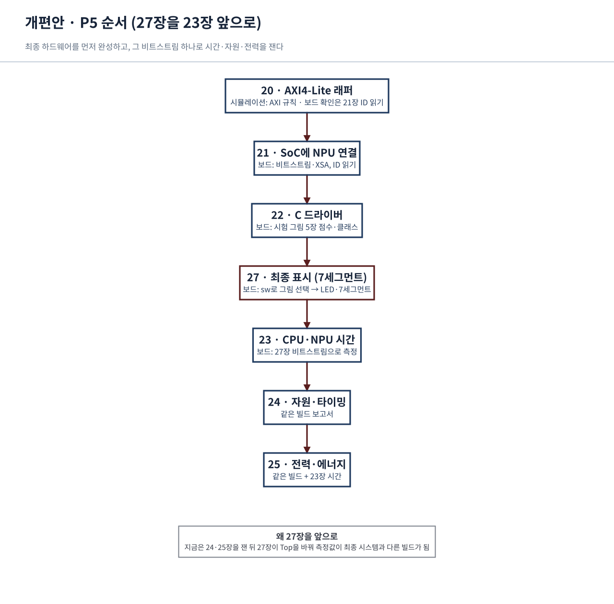

# 개편안 — 장(프로젝트) · 서브젝트 구조, 누적 보드 확인 (설계, 2026-11-19)

> 상태: **설계안**. 코드·안내서는 아직 바꾸지 않았다. 개편 전 결과는 브랜치 `archive/v02-ch00-31`(c7c2341)에 보관했다.
> VS Code 동기화 결과(13~20장 코드, Vivado 증거)가 들어오면 이 표를 그 결과와 맞춘 뒤 개편을 시작한다.

## 1. 원칙

1. **장(프로젝트)마다 보드 Top 하나가 자란다.** 서브젝트는 그 Top에 기능 하나를 더하는 단계다. 단위 합성(OOC)은 보조 확인으로 내린다.
2. **학습목표 = 보드 관찰.** 서브젝트의 목표는 "보드에서 무엇을 넣으면 무엇이 보이는가" 한 줄로 쓴다.
3. **기대 화면을 먼저.** 서브젝트마다 시뮬레이션(또는 펌웨어 기록의 RTL 재생)으로 보드 기대 출력을 만들어 싣는다. 보드 결과를 그 표와 맞춰 본다.
4. **보드에 드러나지 않으면 드러나게.** 비교·측정 서브젝트는 정답 수·CYCLES 값을 UART로 출력해 보드에서 확인한다.
5. **앞 장 파일은 고치지 않고 가져온다.** 장 첫머리에 '가져오는 파일' 표, 끝에 누적 보고서와 시연.
6. **분담.** 웹 Claude: 기대 화면·Top·XDC·절차·안내서. VS Code·보드: 합성·타이밍·비트스트림·보드 확인과 증거.

## 1-1. 장·서브젝트와 '지금 위치'

- **장 = 프로젝트**: 보드 Top 하나, 끝에 보드 시연 하나, 학습 성과 하나. 장 페이지에 목표·최종 구조도·가져오는 파일·시연·누적 보고를 둔다.
- **서브젝트 = 지금의 장**: Top에 기능 하나를 더하는 단계. 서브젝트 페이지는 절차·코드·기대 화면 중심으로 짧게.
- **위치 표시 (모든 서브젝트 페이지 맨 위)**: 장 목표(시연 한 줄) · 진행 막대(예: 3장 ■■□□ 2/4) · 이미 보드에서 확인한 것(앞 서브젝트 결과 목록) · 이번 서브젝트로 새로 보이는 것 · 남은 것.
- **성과 기록**: 서브젝트마다 보드 결과를 기대 화면과 비교한 표 한 줄을 남기고, 장 끝 누적 보고에서 그 줄들을 모아 시연 결과와 함께 성과로 정리한다.
- **번호·폴더**: 화면 표시는 "3-2 그룹·argmax (구 14장)". 폴더 `chNN/`·증거 경로는 VS Code 결과 반영이 끝날 때까지 유지.

## 2. 로드맵

| 장 (프로젝트) | 서브젝트 (지금 장) | 끝 시연 (보드) | 다음 장으로 가져가는 것 |
|---|---|---|---|
| 1장 UART 계산기 | 00~03 | PC가 보낸 두 수의 곱·누산 결과가 UART로 돌아옴 | `uart_core` · `mac_core` |
| 2장 4뉴런 NPU 보드 | 04~12 | UART 적재 → 4뉴런 출력 UART·LED (지금 12장) | UART 적재기 · 4PE · BRAM |
| 3장 8×8 MNIST (CPU 없음) | 13~16 | 8×8 손글씨 → 점수 10개·클래스 UART·7세그먼트 | Dense 코어 · argmax · 입력 계약 |
| 4장 784 가속기 설계 공간 | 17~19 (+06) | 그림 10장 × 설정(INT8·INT16, PE 수) 정답 수·CYCLES 표 UART | 매개변수 784 코어 (NPE=4, INT8) |
| 5장 MicroBlaze V SoC | 20·21·22·27·23·24·25 | CPU 드라이버 추론 + LED·7세그먼트, 같은 빌드로 시간·자원·전력 | SoC · 드라이버 · AXI 래퍼 틀 |
| 6장 응용 확장 | 26·28~31 | 응용 4~5개를 5장 SoC에 붙여 시연 | — |
| 7장 종합과제 | (나중에 검토) | 1~6장을 묶는 과제 | — |

## 3. 5장 순서 바꾸기

지금은 24·25장에서 잰 뒤 27장이 Top을 바꿔, 측정값이 최종 시스템과 다른 빌드의 숫자가 된다. 27장을 22장 바로 뒤로 옮겨 최종 하드웨어를 먼저 완성하고, 그 비트스트림 하나로 23~25장을 잰다.

## 4. 장별 대응표 (학습목표 = 보드 관찰)

작업 구분: **유지** 지금 코드 그대로 · **Top 확장** 프로젝트 Top에 붙여 보드에서 보이게 · **합치기** 중복 코드를 매개변수 하나로 · **신규** 새 RTL·펌웨어

| 지금 장 | 서브젝트 | 학습목표 = 보드에서 보는 것 | 기대 화면 출처 | 작업 |
|---|---|---|---|---|
| 00 UART 에코 | 1-1 | 보낸 글자가 그대로 돌아옴 | 00장 시뮬레이션 | 유지 |
| 01 MAC 누산 | 1-2 | `3 4` → 12, 다시 → 24 (누산) | 01장 기준 모델 | Top 확장 (1장 Top) |
| 02 DSP48E1 곱셈 | 1-3 | 같은 결과 + 보고서에서 DSP 1개 | 02장 시뮬레이션·OOC | Top 확장 |
| 03 MAC 파이프라인 | 1-4 | 결과 같고 응답 지연 클록이 UART에 표시 | 03장 시뮬레이션 | Top 확장 · **신규 1장 Top** |
| 04 BRAM | 2-1 | UART로 쓰고 읽은 값이 같음 | 04장 | Top 확장 |
| 05 양자화 | 2-2 | 보낸 값의 양자화·포화 결과 | 05장 | Top 확장 |
| 06 INT8·INT16 | 2-3 또는 4장 | (결정 필요) 두 폭의 결과 차이 | 06장 | 결정 후 |
| 07 벡터 내적 | 2-4 | 두 벡터 내적 | 07장 | Top 확장 |
| 08 4PE | 2-5 | 4개 내적이 동시에 | 08장 | Top 확장 |
| 09 Dense 4뉴런 | 2-6 | ReLU·양자화된 4뉴런 출력 | 09장 | Top 확장 |
| 10 NPU Core | 2-7 | 적재 후 한 번의 시작으로 4뉴런 | 10장 | Top 확장 |
| 11 UART 적재 컨트롤러 | 2-8 | 명령으로 가중치·입력 적재·실행 | 11장 | 유지 |
| 12 통합 Top | 2-9 (시연) | 4뉴런 출력 UART·LED | 12장 | 유지 |
| 13 입력 적재기 | 3-1 | 64화소 적재 뒤 되읽기 일치 | 13장 | Top 확장 · **신규 3장 Top** (11장 적재기 확장) |
| 14 4+4+2 그룹·argmax | 3-2 | 점수 10개·클래스 | 14장 | Top 확장 |
| 15 Dense 공통 블록 | 3-3 | 같은 결과, 적재 검증합 UART 표시 | 15장 | Top 확장 · 14장과 계보 정리 |
| 16 2층 64→8→10 | 3-4 (시연) | 은닉 8개·점수·클래스, 7세그먼트 | 16장 | Top 확장 |
| 17 784 타일 | 4-1 | 784 입력의 점수·클래스, 타일 수 | 17장 | **합치기** (17·18·19 → 매개변수 코어) |
| 18 정밀도 | 4-2 | INT8·INT16 정답 수 (그림 10장) | 18장 PC·RTL | 합치기 · 보드 비교 펌웨어 없음 → **신규** |
| 19 PE 수 | 4-3 (시연) | NPE별 CYCLES 표 | 19장 사이클 식 | 합치기 (비트스트림 NPE별) |
| 20 AXI4-Lite | 5-1 | (시뮬레이션) AXI 규칙 — 보드는 5-2 | 20장 | 유지 |
| 21 SoC 연결 | 5-2 | ID 0x4E505531 읽기 | 21장 정적 검사 | 유지 |
| 22 C 드라이버 | 5-3 | 그림 5장 점수·클래스 UART | 22장 RTL 재생 | 유지 |
| 27 최종 표시 | 5-4 | sw로 그림 선택 → LED·7세그먼트 | 27장 DEMO 줄 | 유지 (순서만) |
| 23 CPU·NPU 시간 | 5-5 | CSV: CPU·NPU 클록 | 23장 추정 | 유지 (27장 비트스트림으로) |
| 24 자원·타이밍 | 5-6 | 보고서 표 | 24장 해석기 | 유지 |
| 25 전력·에너지 | 5-7 (시연) | 추론 1회 에너지 | 25장 계산기 | 유지 |
| 26 소형 CNN | 6-2 | CNN 클래스 UART·7세그먼트 | 26장 | **신규 AXI 래퍼** |
| 28 손글씨 전송 | 6-1 | PC 손글씨 → 보드 = PC | 28장 RTL 재생 | 유지 |
| 29 센서 + AI | 6-3 | 가상 센서 상태가 LED·7세그먼트 | 29장 | **신규 AXI 래퍼** |
| 30 모터 인터록 | 6-4 | 인터록 비트·PWM이 LED·Pmod (모터 없음) | 30장 | **신규 AXI 래퍼** |
| 31 인증 틀 | 6-5 | 변조 틀 거부, 정상 틀만 분류 | 31장 PC 시험 | **신규 보드 통합 펌웨어** |

## 5. 진행 단계

| 단계 | 내용 | RTL 변경 | 선행 조건 |
|---|---|---|---|
| 1 문서 구조 | `chapter.json`에 `project`·`board_goal` 추가, 프로젝트 첫 페이지·누적 구조도, 5장 순서, 장 표시 "5-3 (22장)" (폴더·번호 유지) | 없음 | VS Code 동기화 |
| 2 코드 계보 | 14·15·17·18·19 → 매개변수 코어 하나 + 이전 결과 교차 확인 | 있음 | 1단계 |
| 3 보드 Top 채우기 | 1장 Top, 3장 Top, 4장 비교 펌웨어, 6장 AXI 래퍼 3개, 31장 통합 펌웨어 | 있음 | 2단계, VS Code 합성 |
| 4 종합과제 | 범위·평가 결정 후 추가 | — | 나중에 검토 |

## 6. 결정 필요

- 서브젝트 페이지 형식: 8절 구조는 장 페이지가 맡고 서브젝트는 절차 위주로 줄이기 (추천) 또는 서브젝트에도 8절 유지
- 폴더: `chNN/` 유지 후 안정되면 이동 검토 (추천)
- 06장: 2장 서브젝트(2-3)로 두기 또는 4장으로 합치기
- 1장·3장 보드 Top의 UART 명령 형식을 11장 형식과 통일할지 (추천: 통일)
