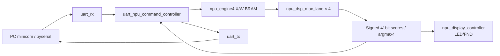

# 📘 제3부 · 준비~12장 기초 NPU 테크트리

> 제3부 정규 범위는 **준비 00장 + 01~31장**으로 확정했다. 전체 편성은 [TECHTREE_00_31.md](TECHTREE_00_31.md)를 참조한다. 이 문서는 00~12장의 기존 RTL 범위와 원형 NPU를 기록한다.

## 1. 제작 원칙

- 저장소: `Yuul-Jung/amd_soc_rtl`, 산출물 `part03/`.
- 원본 01~10장 검증된 독립 RTL은 `Yuul-Jung/amd_soc/part03`에서 내용을 변경하지 않고 이관함. 실제 생성된 새 `mini_npu`와 구분함.
- 학습안내서: 기본 배경 #F1F2EE·보라색 #4635B1·왼쪽 차시/절 내비게이션을 `rule_md` HTML 표준으로 적용.
- 00 준비 + 01~12장, 총 13개 화면. 모듈 설계(01~10)→UART 직접 모델 적재(11)→완성형 추론(12) 흐름.
- 실물 Basys3 검증은 후반 사용자 참여 일괄 수행한다. 이 저장소의 새 코드가 GitHub에 있다는 사실만으로 RTL_SIM_PASS가 아니다.

## 2. 핵심 코드·실습 표

| 단계 | 완성할 하드웨어 | 주요 RTL / 실행기 | 학습·검증 목표 |
|---|---|---|---|
| 00 | 물리 UART 8N1 RX/TX | `uart_rx.v`, `uart_tx.v`, `uart_echo_controller.v` | A/5 bit-level 에코 |
| 01 | signed MAC 누산기 | `mac_core.v` | 16×16→40 누산/clear |
| 02 | DSP48E1 추론 가능한 곱 | `dsp_multiplier.v` | registered product/valid |
| 03 | Pipeline MAC | `mac_pipeline_core.v` | bubble·clear·valid 정렬 |
| 04 | 동기 BRAM | `bram_sync_buffer.v` | 쓰기→1클록 read valid |
| 05 | 고정소수점 양자화 | `fixed_quantizer.v` | SHIFT·반올림·포화 |
| 06 | INT8/16 비교 | `precision_compare.v` | 정밀도별 범위/절삭 |
| 07 | Vector Dot | `vector_dot_core.v` | 길이/종료/부분곱 |
| 08 | 4PE | `pe_array4.v` | 뉴런 4개 개별 점수 |
| 09 | Dense4 | `dense_layer4.v` | bias·ReLU·quantize |
| 10 | 원본 4뉴런 NPU | `npu_core.v` | X/W BRAM→Dense4 |
| 11 | UART X/W/B 직접 모델 적재 | `uart_npu_command_controller.v` | 명령 유효성/ACK/Busy |
| 12 | Basys3 UART 4부류 NPU | `npu_engine4.v`·`basys3_npu_top.v` | DSP→누산→wide 점수→Argmax→UART |

## 3. 12장 목표 시스템



- 4개 고정 표본 `0`..`3`으로부터 결과 CLASS 0..3.
- 11장 `B neuron3 +10` 모델 변경 후 같은 표본 0의 분류는 CLASS3.
- 02 DSP와 누산 단계의 실제 2단계 데이터 경로 포함. **구 03장 `mac_pipeline_core` 모듈을 12장에 직접 포함하지 않았으므로, 03 원본 연결 요구를 완료했다고 간주하지 않는다.**
- 12장 점수는 41bit signed; 음수 점수를 조기 ReLU/16bit 포화하지 않고 Argmax 수행. 13장 이후 10class 확장에 필요한 규칙을 미리 반영.
- 1~10장 기존 성공 증거는 신설 00/11/12장과 독립적으로 기록.

## 4. 실행

```bash
# 1. 설치 도구 확인
command -v iverilog
command -v vvp
command -v python3

# 2. 00장 UART Echo
bash part03/ch00/scripts/run_sim.sh

# 3. 11/12장 DSP/4PE 독립 연산 시험
bash part03/mini_npu/scripts/run_engine.sh

# 4. UART 입력→실 NPU→UART 출력 비트 복조
bash part03/mini_npu/scripts/run_demo.sh

# 5. 00~12장 원본 01~10장 포함 전체 회귀
bash part03/mini_npu/scripts/run_batch_00_12.sh

# 6. UART FIFO·명령 경계 시험
bash part03/mini_npu/scripts/run_adversarial.sh
```

## 5. 필수 후속 검증

- 2026-11-17 로컬 Icarus 12.0에서 00~12장 회귀 13단계와 UART FIFO·명령 경계 시험 19항목 PASS. 기록: `part03/validation/P3_00_12_LOCAL_RTL_SIM_20261117_v01.md`.
- 실물 FPGA에서 UART B18/A18, CLK W5, btnC U18, LED/FND XDC 핀 검증. 대상 합성/타이밍 미실행.
- 11장 현재 바이너리 페이로드의 ACK를 수신하고 다음 명령을 보내는 stop-and-wait 프로토콜. 대용량 패킷 CRC/HMAC은 31장 별도 범위.
- UART Core에는 RX/TX 각각 **16바이트 FIFO**가 있다(RX 최대 17바이트 보관 후 overrun 래치). 동시 Push/Pop·Full/Empty·Overrun·연속 전송 경계 시험은 RTL 시뮬레이션 PASS. 명령 Timeout은 없어 중단된 명령은 Reset으로 복구한다.
- 원본의 모든 기능을 새 통합 경로에 모듈 인스턴스별로 재연결한 상태는 아니다. 실제 12장에서는 02 DSP, 04 BRAM 패턴, 4PE 및 11장 명령 처리 기능을 독립 재구성·재사용한다.
