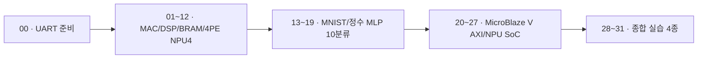

# 제3부 · 준비 00장 및 01~31장 확정 테크트리

> 기준: 2026-11-17 / 기준 저장소: `Yuul-Jung/amd_soc_rtl/part03`
>
> **확정 범위:** 준비 00장 + 정규 01~31장. 32장 이후 산업안전 특화 확장안은 현재 제작·목차에서 제외.
>
> 본 문서는 편성·학습 코드·검증 상태를 구분한다. 페이지의 존재를 FPGA 회로 검증 또는 실습 완료라고 간주하지 않는다.

## 1. 전체 흐름



- **제3부 핵심:** 4분류 원형 NPU → 10분류 정수 모델 → CPU·NPU 결합 → 종합 제작과제.
- **제4부로 이관:** 일반화된 CDC, DMA 대규모 데이터 이동, 시스템 전력·타이밍 클로저 심화.
- **제5부로 이관:** SystemVerilog Assertion/Functional Coverage/UVM 전문 검증.
- **교육 원칙:** 기존 00~12장 정상 RTL을 대량 재작성하지 않는다. 후속 장은 모듈별 선행 계약과 테스트를 먼저 확립한다.

## 2. 확정 장별 편성

| 장 | 과제 | 1차 산출물 | 증거·현재 상태 |
|---|---|---|---|
| 00 | UART Echo 준비 | 물리 UART 에코 TB | 신규 RTL 시뮬레이션 대기 |
| 01 | MAC 누산 | MAC 원본 RTL/TB | 기존 독립 RTL 기록 보존 |
| 02 | DSP48E1 곱 | DSP 원본 RTL/TB | 기존 독립 RTL 기록 보존 |
| 03 | Pipeline MAC | 파이프라인 원본 RTL/TB | 기존 독립 RTL 기록 보존 |
| 04 | BRAM 동기 버퍼 | BRAM 원본 RTL/TB | 기존 독립 RTL 기록 보존 |
| 05 | Fixed Quantizer | 양자화 원본 RTL/TB | 기존 독립 RTL 기록 보존 |
| 06 | INT8·INT16 비교 | 정밀도 원본 RTL/TB | 기존 독립 RTL 기록 보존 |
| 07 | Vector Dot | 내적 원본 RTL/TB | 기존 독립 RTL 기록 보존 |
| 08 | 4PE 병렬 연산 | 4PE 원본 RTL/TB | 기존 독립 RTL 기록 보존 |
| 09 | Dense4 | Dense4 원본 RTL/TB | 기존 독립 RTL 기록 보존 |
| 10 | 4뉴런 NPU | 소형 NPU 원본 RTL/TB | 기존 독립 RTL 기록 보존 |
| 11 | UART 모델 적재 | UART Command Controller·TB | 신규 통합 RTL 시뮬레이션 대기 |
| 12 | UART·DSP·BRAM·4PE 통합 | NPU4 Top/Engine·TB·XDC | 신규 통합 RTL 시뮬레이션 대기 |
| 13 | 8×8 손글씨·10분류 준비 | MNIST 전처리·모델 계약 | HTML 가이드/호스트 예제 작성, 해당 RTL 및 실물 미검증 |
| 14 | 4PE 10분류 그룹 스케줄 | 4PE 그룹 스케줄 계약·호스트 판정 | HTML 가이드/호스트 예제 작성, 해당 RTL 및 실물 미검증 |
| 15 | 64→10 정수 분류기 | 64×10 정수 Python 기준모델 | HTML 가이드/호스트 예제 작성, 해당 RTL 및 실물 미검증 |
| 16 | 64→8→10 정수 MLP | 64→8→10 기준모델·ReLU | HTML 가이드/호스트 예제 작성, 해당 RTL 및 실물 미검증 |
| 17 | 784픽셀 분할 누산 | 784픽셀 64단위 타일 기준모델 | HTML 가이드/호스트 예제 작성, 해당 RTL 및 실물 미검증 |
| 18 | 정수 양자화·범위 검증 | INT8/16 반올림·포화 기준모델 | HTML 가이드/호스트 예제 작성, 해당 RTL 및 실물 미검증 |
| 19 | PE·BRAM 처리량 비교 | PE1/4/8 발행주기 분석 | HTML 가이드/호스트 예제 작성, 해당 RTL 및 실물 미검증 |
| 20 | AXI4-Lite NPU 제어 IP | AXI 주소·레지스터·시뮬레이션 설계 | HTML 가이드/호스트 예제 작성, 해당 RTL 및 실물 미검증 |
| 21 | MicroBlaze V SoC·NPU 결합 | BD·Reset·CPU/NPU 연결 가이드 | HTML 가이드/호스트 예제 작성, 해당 RTL 및 실물 미검증 |
| 22 | Vitis C 추론 드라이버 | C Register Driver 예제·주소 확인 | HTML 가이드/호스트 예제 작성, 해당 RTL 및 실물 미검증 |
| 23 | CPU/NPU 성능 비교 | 성능 측정식 및 측정 포인트 | HTML 가이드/호스트 예제 작성, 해당 RTL 및 실물 미검증 |
| 24 | LUT/FF/DSP/BRAM·타이밍 | report_utilization·WNS/TNS 절차 | HTML 가이드/호스트 예제 작성, 해당 RTL 및 실물 미검증 |
| 25 | 동적 전력·추론 에너지 | 동적/정적 전력 구분식 | HTML 가이드/호스트 예제 작성, 해당 RTL 및 실물 미검증 |
| 26 | 3×3 소형 CNN 경로 | 3×3 합성곱 Python 기준 | HTML 가이드/호스트 예제 작성, 해당 RTL 및 실물 미검증 |
| 27 | 10분류 NPU SoC 통합 | 통합 시스템 Gate 체크리스트 | HTML 가이드/호스트 예제 작성, 해당 RTL 및 실물 미검증 |
| 28 | 손글씨 숫자 인식 종합 | 10분류 시스템 구성·로그 | HTML 가이드/호스트 예제 작성, 해당 RTL 및 실물 미검증 |
| 29 | 센서 융합 산업안전 감시 | 센서 유효성·AI 경보 정책 | HTML 가이드/호스트 예제 작성, 해당 RTL 및 실물 미검증 |
| 30 | NPU·모터 안전 제어 | 독립 모터 안전 인터록 정책 | HTML 가이드/호스트 예제 작성, 해당 RTL 및 실물 미검증 |
| 31 | AES-128·HMAC 보안 UART | AES-CTR·HMAC 호스트 예제 및 인증 계약 | HTML 가이드/호스트 예제 작성, 해당 RTL 및 실물 미검증 |

## 3. 적대적 검증에서 확정한 설계 경계

1. **4분류 ≠ 10분류.** 기존 `npu_engine4.v`는 4뉴런·최대 64원소 입력만 지원한다. 14장 10분류를 구현하려면 **3그룹 실행·출력 누산·클래스 매핑**을 새로 설계해야 하며, 기존 12장을 그대로 사용했다고 주장할 수 없다.
2. **64입력 ≠ 784픽셀.** MNIST 원본은 28×28로 784픽셀. 8×8 실습은 다운샘플 64차원으로 명확히 표기하고, 동일 모델인 듯 혼동하지 않는다. 784 원본은 64+64+…+16의 13개 타일로 분할한다.
3. **NPU4 ≠ NPU10.** 10클래스·64입력 단층 모델에 필요한 곱은 640개. 64×8→8×10 다층 모델에는 512+80=592개. 성능 비교에는 클록 처리·BRAM·스케줄 지연을 별도로 반영한다.
4. **INT8/INT16 정수 계약.** Python `round_shift_away`, `sat_int8` 함수의 계산과 RTL 결과를 대조한다. 단정밀도 float 학습 모델의 출력과 자동으로 같아진다고 주장하지 않는다.
5. **AXI4-Lite와 메모리 대역폭 분리.** AXI4-Lite는 START/STATUS/LENGTH/CLASS 등 작은 레지스터 제어 중심. 대량 입력·가중치 전송은 버스·BRAM·성능 제약을 확인해 설계한다. 관련 IP가 실제 Vivado에서 연결되기 전에는 사용 가능하다고 단정하지 않는다.
6. **MicroBlaze V 실물 정합성.** 주소 맵·XSA·BSP `xparameters.h`·Vitis 예제의 BASEADDR을 실제 생성 값으로 일치시킨다. 예시 주소를 고정 사실로 교재에 기록하지 않는다.
7. **Basys3 자원 한계.** 영상 전체 프레임·고배열 CNN을 무조건 온칩 BRAM에 올리지 않는다. FPGA XC7A35T의 DSP/LUT/BRAM 자원 추론은 Vivado 보고서로 확인한다.
8. **안전 제어 분리.** 29장 산업 안전 분류는 학습용 예시, 30장 모터는 AI 출력을 보호장치로 사용하지 않는다. 비상정지·인터록은 NPU와 독립된 로직/하드웨어가 우선한다.
9. **암호화와 인증 분리.** 31장 AES-128은 기밀성, HMAC-SHA-256은 키 기반 인증. SHA-256 단독 Digest는 인증이 아니다. AES-CTR Nonce 중복·Replay 방지·모델 Atomic Commit을 별도로 다룬다.
10. **검증 Gate 분리.** `자료작성` / `HOST_MODEL_PASS` / `RTL_SIM_PASS` / `SYNTH_TIMING_PASS` / `BOARD_PASS` / `WEB_PASS`는 서로 대체할 수 없다.

## 4. 호스트 독립 검증과 실행 경로

```bash
# (검증) 13~19장 기준 정수 모델 자체 시험
python3 part03/host_tools/p3_integer_reference.py

# (검증) 제3부 32개 학습안내서 및 기존 01~10장 SHA·XDC 정적 검사
python3 part03/validation/check_static.py

# (기존) 신규 00·11·12장 및 원본 01~10장 회귀 — Icarus 도구 설치 환경에서만
bash part03/mini_npu/scripts/run_batch_00_12.sh
```

- 코드·테스트가 별도로 없는 13~31장에 대해서는 **실제 RTL 구현 완료를 주장하지 않는다.**
- 보드·합성 검증은 VS Code/실기 환경에서 받은 증거와 RTL 소스 SHA를 연결하여 판정한다.
- HTML은 `rule_md/web/education-html/STANDARD.md`와 동일한 교육 브랜드 디자인/번호/탐색을 사용한다.
