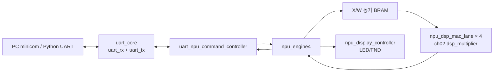

# 제3부 · 00~12장 CPU 없는 UART 누적형 NPU

## 1. 실제 회로 연결



- Top: `basys3_npu_top.v`은 보드 포트·wire·모듈 연결만 수행.
- 100MHz 클록, 115200bps, UART 8N1, 리셋 btnC(눌림 = 리셋).
- 01~10장 원본 RTL/TB와 과거 PASS 기록은 별도로 보존; `mini_npu`는 **신규 통합 설계**.
- 실제 DSP registered product와 다음 에지의 signed 누산, 동기 X/W 읽기, 4개 독립 점수의 signed 41비트 Argmax.
- 4PE는 병렬 4개 뉴런 점수를 계산하며 '4개 합'을 하나의 분류 점수로 사용하지 않음.
- Reset 때 BRAM 저장 내용은 지우지 않지만, 주소별 유효 비트는 지움. RUN 전에 모든 요구 주소를 적재해야 함.
- 이 통합 경로는 기존 `mac_pipeline_core.v` 자체를 직접 인스턴스화하지 않는다. 원본 03장 Pipeline는 단독 실습/회귀로 보존한다. **02 DSP 등록 단계와 후속 누산 단계의 실파이프라인은 구현되지만, 03장 원본을 통합했다고 표현하지 않는다.**

## 2. 11장 UART 모델 직접 적재 프로토콜

CPU 없이 PC UART에서 전송한다. 실습용 **단일 바이트 opcode + 고정 바이트 페이로드(빅엔디언, stop-and-wait)** 방식으로 정했다.

| 명령 | 추가 페이로드 | 의미 | 응답 |
|---|---|---|---|
| ASCII `0` ~ `3` | 없음 | 고정 2입력·4가중치 그룹과 Bias=0 적재 후 추론 | `Ck:score0,score1,score2,score3\\r\\n` |
| ASCII `X` | `addr(1),data_hi(1),data_lo(1)` | X[0..63] signed16 쓰기 | `OK\\r\\n` |
| ASCII `W` | `neuron(1),addr(1),data_hi(1),data_lo(1)` | W[neuron 0..3][addr] signed16 | `OK\\r\\n` |
| ASCII `B` | `neuron(1),bias(5 bytes)` | Bias[0..3] signed40 쓰기 | `OK\\r\\n` |
| ASCII `R` | `length(1)` | length 1..64 추론 시작 | `Ck:...\\r\\n` 또는 `ERR\\r\\n` |
| ASCII `S` | 없음 | 준비 상태 확인(Idle 시) | `I\\r\\n` |

**중요:** 위 표의 `X/W/B/R` 페이로드는 ASCII 십진수가 아닌 **바이너리 바이트**이다. `moserial/minicom`에서는 `0..3` 확인이 편리하고, 11장의 직접 주소/값 쓰기는 PC `pyserial` 또는 저장된 바이너리 전송 파일을 사용한다. 모델 적재 전 64개 전체를 쓰지 않으면 `R length`가 `ERR`를 낼 수 있다.

- signed41 결과는 11자리 대문자 16진수 4개를 콤마로 구분. 음수는 44비트로 부호 확장한 표시값.
- 예: `0`의 결과는 CLASS0, 원점수 `+2,0,0,-2`. 화면 표시 점수에는 4부류 예시의 ReLU를 적용하지 않으며 **signed raw 점수**를 반환한다.
- PC는 각 응답 LF까지 기다린 다음 다음 명령을 전송한다. 초당 115200bps UART는 바이트별 10bit 전송 오버헤드.
- 아직 일반 UART RX 쪽 깊은 FIFO, CRC/인증, 전체 패킷 재전송·모델 버전 관리를 구현한 상태가 아니다. 31장의 보안 프로토콜로 혼동하지 않음.
- Output error LED15는 UART overrun/framing/명령 오류/NPU error가 발생한 경우 latched 상태.

## 3. VS Code / Ubuntu 실행

저장소 루트를 VS Code에서 연 뒤 다음을 순서대로 실행한다.

```bash
# Icarus Verilog와 vvp 사용 가능 여부 확인
command -v iverilog
command -v vvp

# 00 준비 단독 UART 비트파형 Echo
bash part03/ch00/scripts/run_sim.sh

# 02장 DSP + 04장 BRAM + 4PE 통합 정수 검증
bash part03/mini_npu/scripts/run_engine.sh

# 12장 최종 UART bit-level 입력→출력·PC CSV 기준값 비교
bash part03/mini_npu/scripts/run_demo.sh

# 00~12장 원본 10장 회귀 + 통합 전체 검사
bash part03/mini_npu/scripts/run_batch_00_12.sh
```

- `outputs/predictions.csv`, `outputs/demo_result.txt`는 **실제로 run_demo를 실행할 때** 생성된다.
- 회귀 결과는 `validation/local_runs/`에 실행 시각별 보관. 실패 시 빠져나가며 PASS 보고 금지.
- 본 소스가 GitHub에 존재한다는 것만으로 `RTL_SIM_PASS`, `SYNTH_TIMING_PASS`, `BOARD_PASS`가 아니다.
- Basys3 실물 연결·비트스트림·UART LED/FND 관찰은 사용자와 후반 일괄 검증한다.

## 4. 선수 실습과 미검증 경계

- 01 MAC, 02 DSP, 03 Pipeline, 04 BRAM, 05 Fixed, 06 INT8/16, 07 Dot, 08 PE4, 09 Dense4, 10 NPU4는 **원본 독립 소스**와 과거 독립 시뮬레이션 기록이 있다.
- 00 UART, 11 Write, 12 Integration은 이번 신규 구현이다.
- 기존 03 Pipeline를 통합 회로에 직접 편입시키는 일, RX FIFO·stop-and-wait 위반 에러 처리, 합성 BRAM/DSP 매핑·Timing 등은 **후속 게이트**로 남기며 미완료 항목을 숨기지 않는다.
- 13~19장 MNIST/멀티레이어, 20장 이후 AXI/MicroBlaze V는 이 디렉터리의 범위 밖이다.
